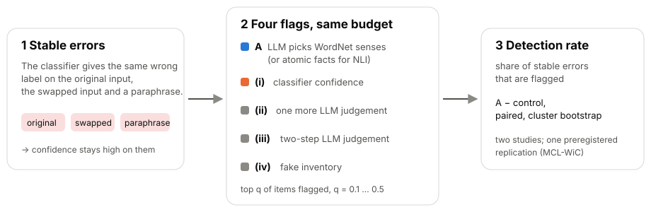
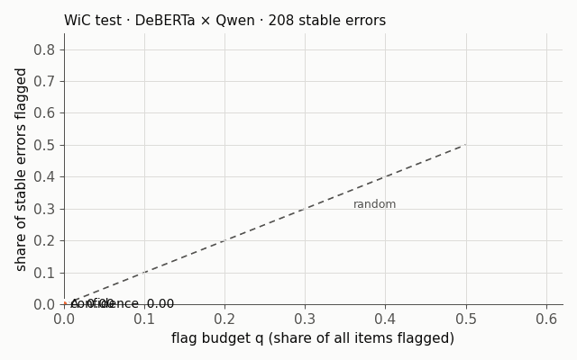
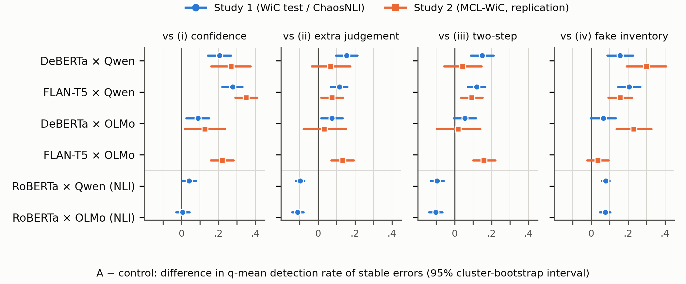

<p align="center">
  
</p>

<p align="center">
  <a href="https://doi.org/10.5281/zenodo.24132225"></a>
  <a href="https://doi.org/10.5281/zenodo.24132227"></a>
  
  
  
  
</p>

<p align="center">
  <a href="README.md">English</a> · <b>日本語</b>
</p>

Mikoto Miura・Yuusuke Harada による論文「**Flagging stable classifier errors with an inventory-mediated LLM judgement: an exploratory study and a preregistered replication**」（プレプリント、査読中）のコードと集計の出力です。

> **ひとことで言うと。** WordNet の語義の目録を介した LLM の判断と分類器との食い違いは、分類器が**繰り返す**誤りを、分類器自身の信頼度より多く拾います。ただし、そのうち目録そのものが要った分（もう 1 回の判断でも届く分ではないもの）は決められませんでした。

---

## しくみ

<p align="center">
  
</p>

- **安定した誤り**：元の入力・2 文を入れ替えた入力・言い換えのすべてで、分類器が同じ誤ったラベルを出す誤りです。出力の食い違いを探す検出器には見えず、信頼度も高いままです。
- **手法 A**：LLM が各文の対象語の WordNet の語義を選び、分類器との食い違いを旗にします。NLI では、原子的な事実とラベルの定義を使います。
- **公平な比較**：どの手法も、同じ割合 q の項目に旗を立てます。比べる相手は、(i) 信頼度、(ii) LLM にもう 1 回判断させる、(iii) 2 段の判断、(iv) 偽の目録 です。

## 動きで見る

<p align="center">
  
</p>

<sub>WiC test、DeBERTa × Qwen。公開している項目ごとの出力（`papers/bics/data/item_outputs.csv`）から描いています。境界での同点を、ここでは項目の順で、論文では端数で分けているので、目安として見てください。q = 0.1〜0.5 の平均で、論文の値は A 0.509、信頼度 0.303 です（無作為の期待値は 0.30）。</sub>

## 主な結果

| | 結果 | 位置づけ |
|---|---|---|
| 🔵 **A は安定した誤りで信頼度に勝つ** | WiC 型の 7 構成すべてで。DeBERTa × Qwen は 0.206 [0.142, 0.268]（研究 1）、0.268 [0.161, 0.374]（研究 2） | 探索 / 中止（記述） |
| ⚖️ **目録が要った分は？** | 働く判定器である構造なしの 2 回目の判断だけで、A の上乗せの 25〜78% に届く | 事後 |
| 🧭 **上乗せの一部は偏りの補正** | ラベルを使わずに偏りを補正した判断と比べても、WiC test では上乗せが残る（0.125 [0.066, 0.185]）。MCL-WiC では補正の決め方次第 | 事後 |
| 🧑‍⚖️ **安定した誤りは本当に誤りか** | 研究から独立した 2 名がともに参照ラベルを選んだのは、研究 1 の安定した誤り 208 件中 100 件だけ（正しく分類された項目では 208 件中 180 件） | 事後 |
| 🔶 **NLI** | 原子的な事実を介すと、直接聞くより旗が**悪く**なった（−0.097 [−0.119, −0.075]） | 探索 |

差は検出率の差で、括弧内は 95% のクラスタ・ブートストラップ区間です。

<details>
<summary><b>図 1：A と各対照の差（2 研究）</b></summary>
<p align="center"></p>
</details>

## 証拠の位置づけ

- **研究 1**（WiC test、ChaosNLI）は、事前登録した言い換えの点検が不合格だったため**探索的**になりました。
- **研究 2**（MCL-WiC での事前登録した追試）は、安定した誤りが 91 件で事前登録の下限 100 件に届かず、**凍結した中止の規則で止めました**。
- 確認的な結論は主張しません。事後の分析は、論文の中で [P] と印を付けています。
- OSF の 5 つの事前登録は、出版までエンバーゴ中です。ID・登録日時・ハッシュは、プレプリントの付録 S1 にあります。

## フォルダ構成

```text
.
├── src/                       # データの準備・判定器・採点・凍結した解析コード
├── config.json, rep_config.json, *_manifest.json   # 凍結した設定とファイルのハッシュ
├── experiments/
│   ├── 20261103-evaluation/   # 研究 1 の解析の出力（analysis.json）
│   ├── 20261109-rep-main/     # 研究 2 の解析の出力
│   └── 20261110-adjudication/ # 人の裁定: 手引き・コード・テスト・結果
├── papers/bics/
│   ├── scripts/               # 表・図・事後の分析（P1〜P17）・LaTeX の組版
│   ├── tables/                # 表と事後の分析の出力（JSON）
│   ├── data/                  # item_outputs.csv・adjudication_items.csv（id と数値。文は含まない）
│   └── figures/               # 図 1
└── assets/                    # この README の画像
```

## 再現

Python 3.13 と `numpy==2.5.4` を使います（図には `matplotlib==3.10.7` も使います）。

```bash
# 凍結した解析の出力から、表と図 1 を作る
python -X utf8 papers/bics/scripts/make_tables.py
python -X utf8 papers/bics/scripts/make_figure1.py

# README の画像（ロゴ・概要図・動く図）を作る
python -X utf8 papers/bics/scripts/make_readme_assets.py assets
```

モデルの実行や事後の分析をやり直すには、データセットとモデルの実行出力も要ります。これらはここでは再配布していません（下記）。WiC・MCL-WiC・ChaosNLI は元の配布元から入手してください。期待されるファイルのハッシュは、凍結したマニフェストにあります。

## このリポジトリに**含まない**もの

- WiC・MCL-WiC・ChaosNLI の文（CC BY-NC）。含むのは項目 id とラベルだけです。
- モデルの実行出力、裁定のシートと正解表、評価者の実名（評価者は rater1 / rater2 と表記）。

## 引用

```bibtex
@misc{miura2026stable,
  title  = {Flagging stable classifier errors with an inventory-mediated {LLM} judgement:
            an exploratory study and a preregistered replication},
  author = {Miura, Mikoto and Harada, Yuusuke},
  year   = {2026},
  note   = {Preprint},
  doi    = {10.5281/zenodo.24132225}
}
```

[`CITATION.cff`](CITATION.cff) もあります。

## ライセンス

- **コード**（`src/`、`papers/bics/scripts/`、`experiments/*/scripts/`）：[MIT](LICENSE)
- **それ以外**（表・図・文書・集計の出力）：[CC BY 4.0](LICENSE-CONTENT.md)
- WiC・MCL-WiC・ChaosNLI に由来する項目 id と参照ラベルには、それぞれのデータセットのライセンスが適用されます。

<sub>文章とコードの下書きには LLM（Claude、OpenAI Codex）を使いました。内容はすべて著者が確認し、責任を負います（論文 1 頁目の脚注を参照）。</sub>
