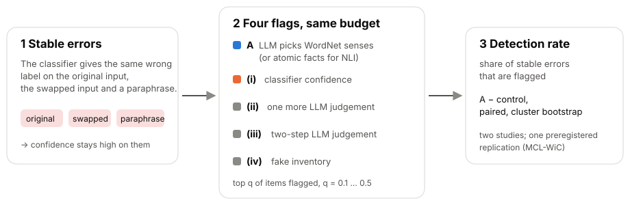
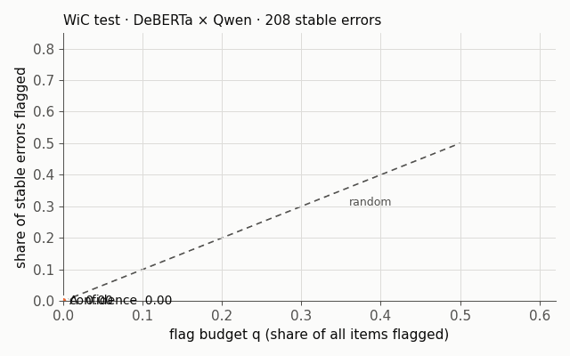
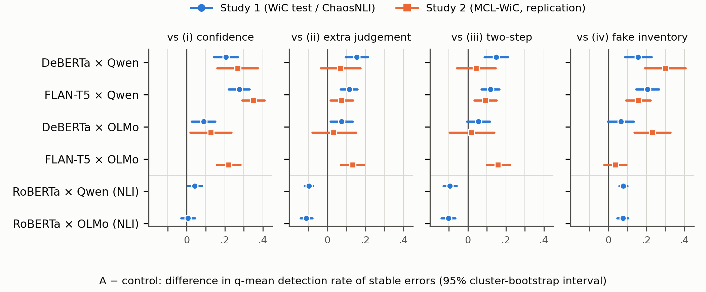

<p align="center">
  
</p>

<p align="center">
  <a href="https://doi.org/10.5281/zenodo.24132225"></a>
  <a href="https://doi.org/10.5281/zenodo.24132227"></a>
  
  
  
  
</p>

<p align="center">
  <b>English</b> · <a href="README.ja.md">日本語</a>
</p>

Code and aggregate outputs for the paper **"Flagging stable classifier errors with an inventory-mediated LLM judgement: an exploratory study and a preregistered replication"** by Mikoto Miura and Yuusuke Harada (preprint, under review).

> **In one sentence.** Disagreement with an LLM judgement that is routed through a WordNet sense inventory flags the errors a classifier *repeats* more often than the classifier's own confidence. How much of that needs the inventory itself, rather than a second judge, could not be pinned down.

---

## How it works

<p align="center">
  
</p>

- **Stable error.** The classifier gives the same wrong label on the original input, on the input with its two sentences swapped, and on a paraphrase. Detectors that look for inconsistency cannot see these errors, and confidence stays high on them.
- **Method A.** The LLM picks the WordNet sense of the target word in each sentence. A disagreement with the classifier becomes a flag. For NLI, A uses atomic facts with label definitions instead.
- **Fair comparison.** Every method flags the same share q of items. A is compared with (i) confidence, (ii) one more LLM judgement, (iii) a two-step judgement and (iv) a fake inventory.

## See it

<p align="center">
  
</p>

<sub>WiC test, DeBERTa × Qwen. The curves are drawn from the released per-item outputs (`papers/bics/data/item_outputs.csv`). Ties at a boundary are split by item order here and fractionally in the paper, so read this as an illustration. Averaged over q = 0.1…0.5, the paper reports 0.509 for A and 0.303 for confidence; the random expectation is 0.30.</sub>

## Key findings

| | Result | Status |
|---|---|---|
| 🔵 **A beats confidence on stable errors** | in all 7 word-in-context configurations; DeBERTa × Qwen 0.206 [0.142, 0.268] (Study 1), 0.268 [0.161, 0.374] (Study 2) | exploratory / aborted (descriptive) |
| ⚖️ **How much needs the inventory?** | a working unstructured second judgement already reaches 25–78% of A's advantage | post hoc |
| 🧭 **Part of the edge is a bias correction** | against a label-free debiased judge, the edge remains on WiC test (0.125 [0.066, 0.185]); on MCL-WiC it depends on the correction | post hoc |
| 🧑‍⚖️ **Are the stable errors errors?** | two independent raters confirmed the reference on only 100 of Study 1's 208 stable errors (180 of 208 for correctly classified items) | post hoc |
| 🔶 **NLI** | routing the judgement through atomic facts made the flag *worse* than asking directly (−0.097 [−0.119, −0.075]) | exploratory |

Differences are in detection rate with 95% cluster-bootstrap intervals.

<details>
<summary><b>Figure 1: A minus each control, both studies</b></summary>
<p align="center"></p>
</details>

## Status of the evidence

- **Study 1** (WiC test, ChaosNLI) became **exploratory** because a preregistered paraphrase check failed.
- **Study 2** (preregistered replication on MCL-WiC) **stopped under its own rule**: 91 stable errors, below the preregistered minimum of 100.
- No confirmatory result is claimed. Post-hoc analyses are marked [P] in the paper.
- The five OSF registrations are under embargo until publication. Their ids, times and hashes are listed in Supplementary S1 of the preprint.

## Repository layout

```text
.
├── src/                       # data preparation, judges, scoring and the frozen analysis code
├── config.json, rep_config.json, *_manifest.json   # frozen configurations and file hashes
├── experiments/
│   ├── 20261103-evaluation/   # Study 1 analysis output (analysis.json)
│   ├── 20261109-rep-main/     # Study 2 analysis output
│   └── 20261110-adjudication/ # human adjudication: guide, code, tests, results
├── papers/bics/
│   ├── scripts/               # tables, figure, post-hoc analyses (P1-P17), LaTeX builds
│   ├── tables/                # rendered tables and post-hoc outputs (JSON)
│   ├── data/                  # item_outputs.csv, adjudication_items.csv (ids and numbers, no text)
│   └── figures/               # Figure 1
└── assets/                    # images for this README
```

## Reproduce

Python 3.13 with `numpy==2.5.4` (`matplotlib==3.10.7` for the figures).

```bash
# Tables and Figure 1 from the frozen analysis outputs
python -X utf8 papers/bics/scripts/make_tables.py
python -X utf8 papers/bics/scripts/make_figure1.py

# README images (logo, overview, animated curve)
python -X utf8 papers/bics/scripts/make_readme_assets.py assets
```

Re-running the models or the post-hoc analyses also needs the datasets and the model run outputs. These are not redistributed here (see below). Get WiC, MCL-WiC and ChaosNLI from their original sources. The frozen manifests list the expected file hashes.

## What is *not* in this repository

- Sentences of WiC, MCL-WiC and ChaosNLI (CC BY-NC). Only item ids and labels are included.
- Raw model run outputs, the adjudication sheet and key, and rater identities (raters appear as rater1 / rater2).

## Citation

```bibtex
@misc{miura2026stable,
  title  = {Flagging stable classifier errors with an inventory-mediated {LLM} judgement:
            an exploratory study and a preregistered replication},
  author = {Miura, Mikoto and Harada, Yuusuke},
  year   = {2026},
  note   = {Preprint},
  doi    = {10.5281/zenodo.24132225}
}
```

See also [`CITATION.cff`](CITATION.cff).

## License

- **Code** (`src/`, `papers/bics/scripts/`, `experiments/*/scripts/`): [MIT](LICENSE)
- **Everything else** (tables, figures, documents, aggregate outputs): [CC BY 4.0](LICENSE-CONTENT.md)
- Item ids and reference labels derived from WiC, MCL-WiC and ChaosNLI remain subject to the licenses of those datasets.

<sub>LLM assistants (Claude, OpenAI Codex) were used to draft text and code. The authors checked everything and take responsibility for it; see the footnote on page 1 of the paper.</sub>
